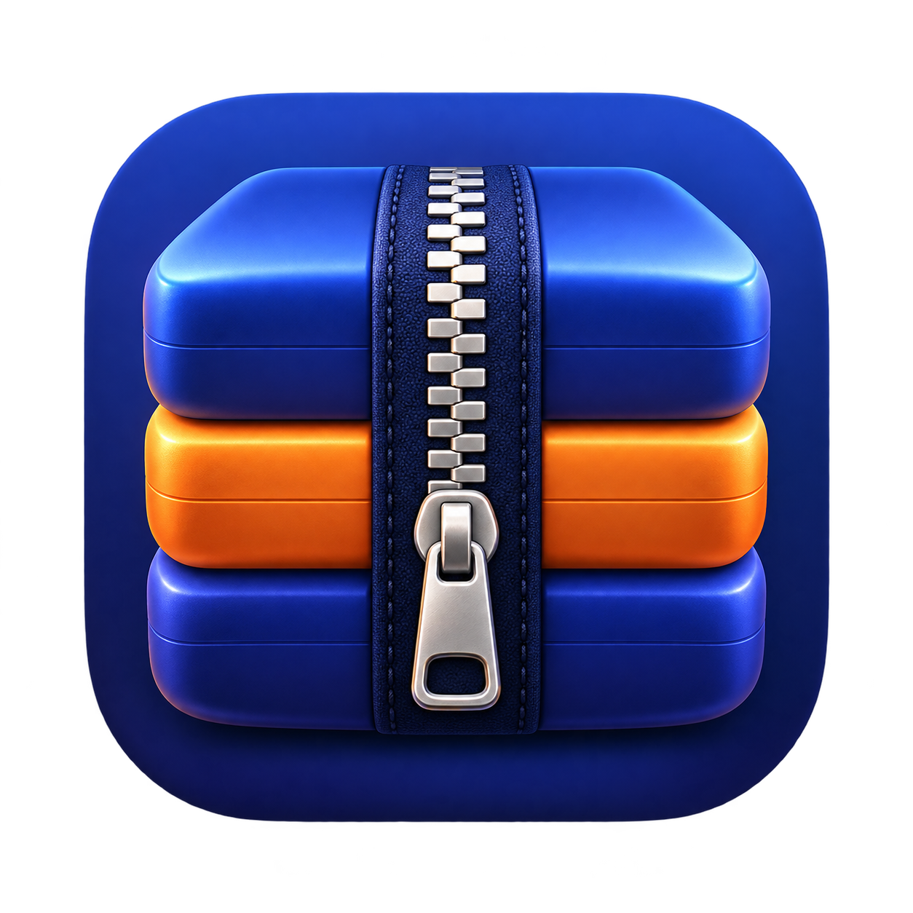

# MacRAR

MacRAR 是 macOS 14 及以上版本的压缩归档工具，支持浏览、创建、解压、测试与转换多种归档。应用基于 SwiftUI、SwiftPM、自有 ZIP 引擎、UnRAR 和 p7zip 16.02。



## 功能

- ZIP 创建、解压、传统加密与分卷
- RAR 解压；创建 RAR 时需另外安装 RARLAB 的 `rar` 命令行工具
- 7z、TAR、GZip、BZip2、XZ 等格式通过随应用提供的 7za 处理
- 中文文件名识别、归档浏览、文件选择与覆盖模式

当前内置 7za 不支持 Zstandard。公开发行版还需要 Developer ID 签名与 Apple 公证；仓库中的构建脚本默认生成供本机测试的临时签名包。

## 构建与测试

需要 Apple Silicon Mac、macOS 14+ 和 Swift 5.9+：

```bash
./Scripts/create_icon.sh
./Scripts/test_release.sh
./Scripts/build_app.sh release
```

打包结果位于 `dist/MacRAR.app` 和 `dist/MacRAR-1.0.0-arm64.dmg`。发布验证步骤见 [RELEASE.md](RELEASE.md)。

## 授权

MacRAR 自有代码采用 [MIT](LICENSE)。随仓库提供的 UnRAR、p7zip 和 7za 遵循各自的授权及使用限制，见 [THIRD_PARTY_NOTICES.md](THIRD_PARTY_NOTICES.md)。整个仓库不能概括为全部采用 MIT。
